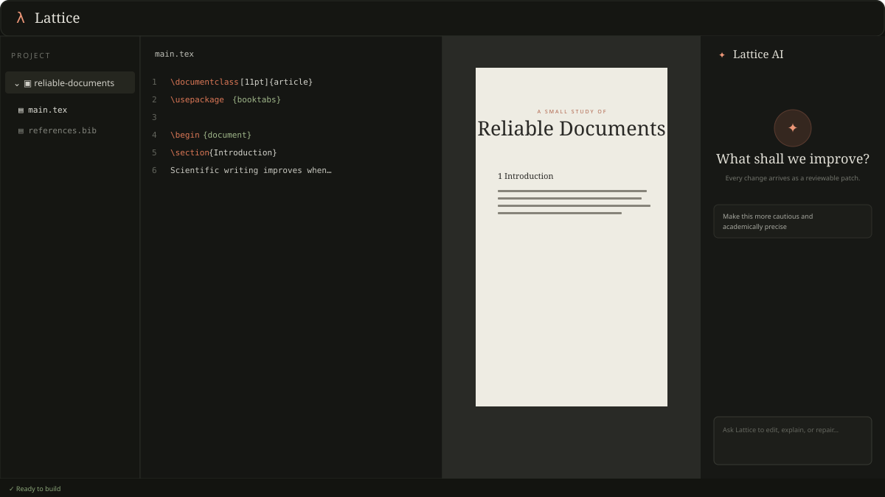

# Lattice

Lattice is a structured, AI-first LaTeX workspace for Linux. It connects source files, rendered pages, diagnostics, and reviewable AI edits without hiding ordinary project folders behind a proprietary format.



## What works in this first milestone

- Open ordinary project folders; no proprietary project format.
- Open projects through a direct GTK folder picker on Linux when `zenity` is available, with the Electron system picker as a fallback.
- Keep multiple projects open in project tabs, with each project retaining its own open files, active document, preview, diagnostics, and SyncTeX position.
- Reopen the previous workspace at desktop startup, restoring project tabs, file tabs, and active selections after validating them against the current folders on disk.
- Keep multiple source files open in editor tabs; reopening a file or project activates its existing tab instead of creating a duplicate.
- Reopen up to ten recent projects from the File menu.
- Edit `.tex`, `.bib`, `.sty`, and `.cls` files with Monaco.
- Typing `_` or `^` in LaTeX inserts `{}` and places the cursor inside. Escaped symbols, comments, pasted text, and operators followed by an existing `{` are left unchanged.
- Autosave edits after a short idle period and whenever the app loses focus, while retaining explicit Save and Save As commands.
- Choose between classic on-demand builds and an opt-in live preview that typesets after typing pauses, coalesces stale requests, runs the compiler at reduced OS priority when available, and automatically falls back to on-demand mode when its background process fails or exceeds the hard timeout.
- Complete LaTeX commands and paired environments with snippets, parameter hints, hover documentation, and project-aware references, citations, custom commands, and file paths.
- Format selections from a compact document toolbar with paragraph styles, bold, italic, underline, monospace, lists, quotes, left/centre/right alignment, links, and inline mathematics.
- Paste multi-row spreadsheet ranges directly into the source editor as escaped, aligned LaTeX tables, or use the table editor to paste and edit cells. Rich spreadsheet paste preserves common fill, text, emphasis, and alignment formatting; click or Shift-click cells—or select whole rows and columns—to apply bold, italic, underline, fill and text colours, per-cell alignment, banded rows, and coloured rules. The editor also configures independent horizontal and vertical line styles, column alignment, table position, font size, row spacing, header and first-column emphasis, plus an optional float placement, caption, and label before insertion. Ctrl/Cmd+Shift-click a supported table in the source, or Shift-click it in a built PDF, to reopen the same graphical editor and replace the original table safely. Packages required by generated formatting are added to the root-document preamble automatically without duplicating packages already loaded.
- Insert common maths notation from a configurable top, bottom, left, or right toolbar, with snippet placeholders for fractions, roots, scripts, calculus, Greek letters, vectors, accents, relations, matrices, cases, and aligned equations.
- Configure twelve personal LaTeX commands in a separate top, bottom, left, or right toolbar, with selection wrapping, cursor placement, numbered Tab stops, and persistent `Shift+F1`–`Shift+F12` shortcuts.
- Check English spelling, grammar, punctuation, and style privately with a LaTeX-aware Harper worker; use inline quick fixes, a personal dictionary, per-suggestion ignores, and regional dialect settings.
- Switch the navigator between the project file tree and a persistent, clickable LaTeX syllabus that follows the current section.
- Drag the editor, Navigator, PDF Preview, and Lattice AI panes among eight optional left, centre, right, and bottom dock slots; resize docks and split panes, with the complete layout restored between launches.
- Personalise the editor font, font size, and one of four coordinated syntax/UI colour themes; choices persist between launches.
- Detect pdfLaTeX, XeLaTeX, and LuaLaTeX from `PATH`.
- Compile through `latexmk`, including bibliography and reference passes.
- Render nearby PDF pages progressively as scalable Poppler glyph paths, preserving TeX's exact font outlines at every zoom without delaying build completion.
- Print the rendered PDF or open it in the operating system's default external PDF viewer.
- Jump from source to PDF and back with build-accurate SyncTeX navigation.
- Ctrl+click a linked PDF table-of-contents entry to open the referenced section in the LaTeX source. Build in the desktop app first; the PDF must contain internal links (for example, generated with `\usepackage[hidelinks]{hyperref}`). Ordinary text and unlinked entries keep their usual PDF-to-source navigation.
- Normalize file/line compiler messages into clickable diagnostics.
- Ask for a whole-file or selection-scoped AI edit.
- Review and accept/reject every AI change as a diff.
- Keep `OPENAI_API_KEY` in the native process, never in browser JavaScript.
- Exercise the UI in a browser demo mode when the native backend is unavailable.

The native application defaults to `shell_escape = false`, constrains reads and writes to the opened project, only writes recognized source formats, and times builds out after 90 seconds.

## Run the web UI

You need Node.js 22.12 or newer. This machine uses `nvm`, so a fresh terminal
will select the installed Node 22 default automatically. In an already-open
terminal, run `nvm use 22` once.

```sh
npm install
npm run dev
```

Open <http://127.0.0.1:1420>. Browser mode uses an interactive sample document and a deterministic AI-edit demonstration.

## Run the Linux desktop application

Install Rust, a TeX Live installation that contains `latexmk`, and Poppler utilities (including `pdftocairo`). On Linux, install `zenity` for the faster direct GTK project picker; Lattice falls back to Electron's system picker when it is unavailable. Then run:

```sh
npm install
npm run desktop
```

The desktop window uses Electron/Chromium, while filesystem access, LaTeX builds,
diagnostics, and AI requests run in the standalone Rust backend. Rust's disposable
build artifacts are placed in `/dev/shm/lattice-backend-target` instead of the project
directory and disappear at reboot.

The document shown at desktop startup is a persistent starter project in Lattice's
application-data directory. It can be saved and built immediately; Lattice creates
it once and preserves subsequent edits across restarts.

On Linux source checkouts, the launcher checks whether Chromium's root-owned SUID
sandbox helper is available. If npm installed the helper as an ordinary user file
(or Ubuntu restricts unprivileged user namespaces), it automatically uses Electron's
development-only `--no-sandbox` fallback. Lattice still disables renderer Node.js
access, enables context isolation, exposes only an allow-listed IPC bridge, and
blocks navigation away from its local UI. A packaged release must use Chromium's
OS sandbox rather than this development fallback.

Lattice detects the following commands at startup:

```text
latexmk  pdflatex  xelatex  lualatex  synctex  pdftocairo  zenity (optional on Linux)
```

Set the API key only in the process environment used to launch the desktop app:

```sh
export OPENAI_API_KEY="..."
export LATTICE_AI_MODEL="gpt-5.6-terra" # optional
npm run desktop
```

The provider call uses OpenAI's Responses API with `store: false` and Structured Outputs. Model output is staged in the UI and is not saved until **Accept edit** and then **Save** are used.

## Keyboard shortcuts

| Action | Shortcut |
| --- | --- |
| Save current file | `Ctrl+S` |
| Save current file as | `Ctrl+Shift+S` |
| Open a project | `Ctrl+O` |
| Print the rendered PDF | `Ctrl+P` |
| Compile project with the selected compiler | `F1` or `Ctrl+Enter` |
| Delete current line | `Ctrl+D` |
| Toggle comment on current line | `Ctrl+M` |
| Bold selected text | `Ctrl+B` |
| Italicise selected text | `Ctrl+I` |
| Underline selected text | `Ctrl+U` |
| Insert custom commands 1–12 | `Shift+F1`–`Shift+F12` |
| Jump from source to the matching PDF position | `Ctrl+click` (`⌘+click` on macOS) in the editor |
| Jump from the PDF to the matching source position | `Ctrl+click` (`⌘+click` on macOS) in the preview |
| Open editor settings | `Ctrl+,` |

The preview mode is configured in **Editor settings → Build & preview**. Live preview waits briefly after the final edit and never overlaps compiler runs. PDF.js loads page geometry and links in a worker while `pdftocairo` converts only nearby pages to self-contained SVG glyph paths, so TeX fonts retain their exact shapes and a build does not wait for every page preview. The build, delete-line, and toggle-comment shortcuts can be changed in **Editor settings → Keybindings**. Custom-command labels and templates are configured in **Editor settings → Custom commands**; use `{{selection}}`, `{{cursor}}`, and fields such as `${1:argument}` to create interactive snippets.

## Architecture

```text
React + TypeScript
  ├─ Monaco editor
  ├─ local Harper writing worker
  ├─ PDF.js workspace + two-way SyncTeX navigation
  ├─ diagnostics UI
  └─ reviewable AI patch UI
             │ secure Electron preload + JSON-RPC
Rust sidecar
  ├─ project/file boundary
  ├─ latexmk build supervisor
  ├─ diagnostic parser
  └─ provider-neutral AI request boundary
             │
  TeX Live / OpenAI Responses API
```

See [docs/ARCHITECTURE.md](docs/ARCHITECTURE.md) for the current boundaries and the next milestones.

## Tests

```sh
npm test
npm run backend:test
```

## License

Apache-2.0. External programs such as TeX Live, `latexmk`, and language servers retain their own licenses and are invoked as separate tools.
